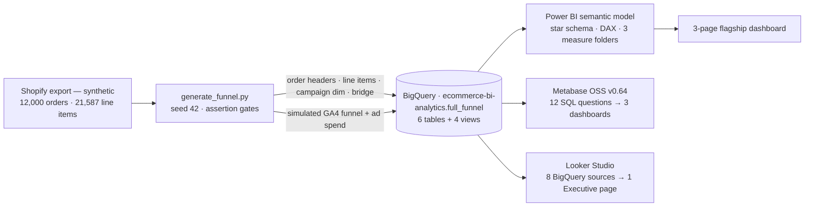
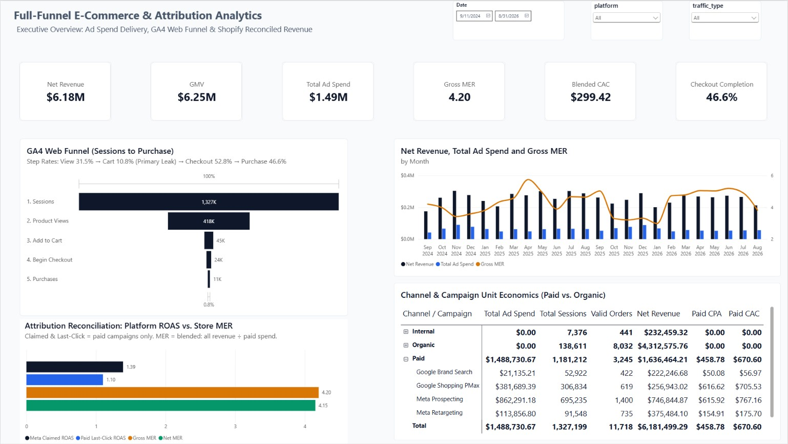
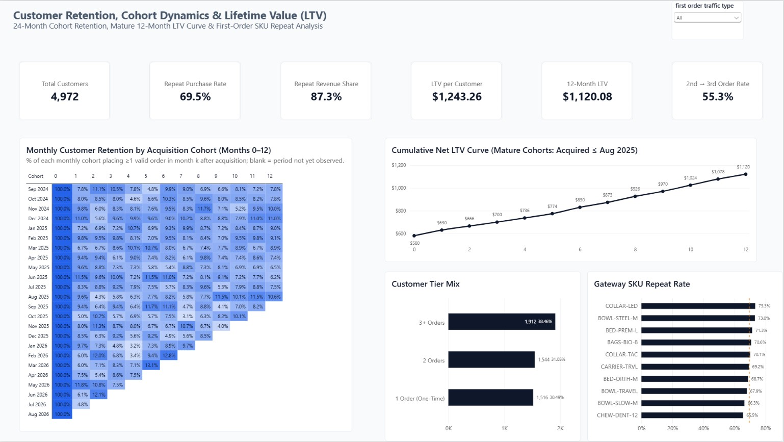
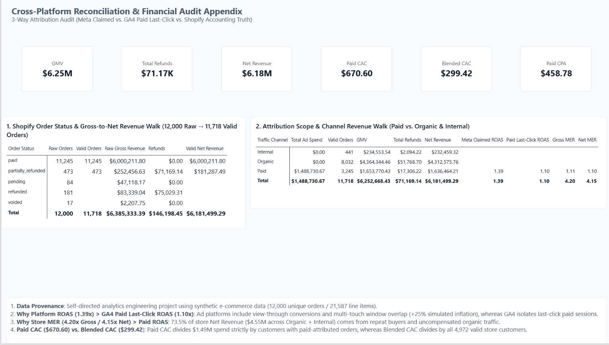
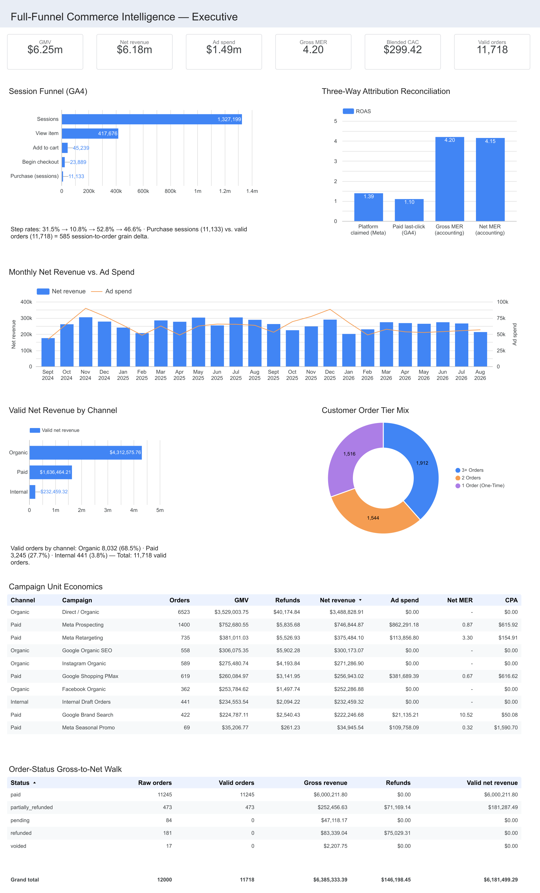

# Full-Funnel Commerce Intelligence — Shopify × GA4 × Meta (BigQuery → Power BI · Metabase · Looker Studio)

A 3-page Power BI flagship built on a BigQuery warehouse: acquisition funnel, retention & cohort LTV, and a 3-way attribution reconciliation — across 24 months, 12,000 orders and $6.25M gross merchandise value. The same four curated views are ported to **Metabase OSS** and **Looker Studio**, so every headline number is reproducible across three BI tools.

> ### ⚠️ Data disclosure — synthetic demonstration data
> This is a **self-directed portfolio project**. It contains **no real customer data** and is **not client work**.
> - Orders/payments come from a synthetic Shopify export (Python/Faker-generated: 12,000 orders, 21,587 line items, Sep 2024 – Aug 2026).
> - The **GA4 funnel and Meta/Google ad-spend layers are simulated** by a seeded generator (`generate_funnel.py`) anchored to those orders — they are not exports from live GA4 or ad accounts, and this project contains **no tracking/tag implementation**.
> - Every invented parameter is documented in the [Synthetic parameter inventory](#-synthetic-parameter-inventory). All published revenue figures are exact sums of the dataset; only the funnel/spend model inputs are made up.

**Skills demonstrated:** dimensional modeling · BigQuery SQL · Power BI / DAX / Power Query · Metabase OSS · Looker Studio · Python (pandas, NumPy) · funnel & cohort analysis · cross-platform metric reconciliation.

---

## 📊 Executive KPI highlights

| Metric | Value | Definition |
| --- | --- | --- |
| Gross Merchandise Value (GMV) | **$6,252,668.43** | Gross order value of valid orders, Sep 2024 – Aug 2026 |
| Net Revenue | **$6,181,499.29** | GMV − refunds ($71,169.14, 1.14%) |
| Valid Orders | **11,718** | paid 11,245 + partially_refunded 473 (282 excluded: refunded / pending / voided) |
| Average Order Value | **$533.60** | GMV ÷ valid orders |
| Customers | **4,972** | Distinct customers on valid orders |
| Repeat Purchase Rate | **69.5%** | Share of customers with 2+ orders |
| Repeat Revenue Share | **87.3%** | $5,398,059.96 of Net Revenue from repeat buyers |
| 12-Month LTV per Customer | **$1,120.08** | Net revenue per customer, months 0–12, mature cohorts |
| Total Ad Spend | **$1,488,730.67** | Simulated paid-media spend at campaign-day grain |
| Gross MER / Net MER | **4.20 / 4.15** | GMV ÷ spend / Net Revenue ÷ spend |
| Blended CPA / CAC | **$127.05 / $299.42** | Spend ÷ all valid orders / all customers |
| Checkout Completion (session grain) | **46.6%** | purchase sessions ÷ begin_checkout sessions |
| Meta-Claimed ROAS vs Paid Last-Click ROAS | **1.39 vs 1.10** | See [3-way reconciliation](#️-three-way-reconciliation-in-words) |

---

## 🏗️ Architecture

**Pipeline at a glance:** the Shopify export is split into order-header and line-item grains → the generator layers campaign attribution, a simulated GA4 session funnel and simulated paid-media spend → everything lands in BigQuery as 6 tables + 4 views → Power BI reads the curated views through a semantic model, while Metabase and Looker Studio query the same views directly. Three BI tools, one metric contract.

---

## 🔄 The pipeline, step by step

1. **Source split (data hygiene).** The Shopify export stores financials on the header row only, while line items repeat per product — loading naively double-counts revenue (~1.8×). The pipeline splits 12,000 order headers (`fact_orders`) from 21,587 line items (`fact_order_items`).
2. **Synthetic enrichment (`generate_funnel.py`).** Every order is assigned exactly one campaign out of 10 (zero NULLs, asserted) using documented paid/organic shares; a daily GA4 session funnel is emitted per campaign so that **purchases tie exactly to the 11,718 valid orders**; ad spend is generated at campaign-day grain and calibrated so gross MER lands at **4.20** (calibration factor 1.08, abort guard 0.5–1.5).
3. **Warehouse (BigQuery).** Dataset `ecommerce-bi-analytics.full_funnel` — 6 tables plus 4 views: `vw_orders_enriched` (adds `cohort_month`, `valid_order_seq`), `vw_daily_full_funnel`, `vw_reconciliation_summary` (paid + blended CPA/CAC), `vw_customers` (**one row per customer — the grain contract behind every cohort denominator**).
4. **Semantic model (Power BI).** Star schema; all relationships single-direction 1→*. `Dim_Date` with `YearMonthSort`; DAX measure folders: *Economics / Funnel & Ad Delivery / Retention & Cohort*. Ratio metrics (ROAS, MER, CPM, CTR, CPC) are **SUM/SUM** — never averages of averages.

---

## ⚖️ Three-way reconciliation (in words)

The appendix page reconciles three "truths" that never quite agree in real life — here, by design and by documentation.

### 1. Shopify — accounting truth
**12,000 raw orders → 282 excluded** (`refunded` 181 / `pending` 84 / `voided` 17) **→ 11,718 valid → GMV $6,252,668.43 → refunds $71,169.14 → Net Revenue $6,181,499.29.**
Same pool by channel: Internal $232,459.32 · Organic $4,312,575.76 · Paid $1,636,464.21 (net).

### 2. GA4 — session truth
1,327,199 sessions → 417,676 view_item → 45,239 add_to_cart → 23,889 begin_checkout → 11,133 purchase sessions (0.84% overall; step rates 31.5% → 10.8% → 52.8% → 46.6%).
Purchase events (11,718) exceed purchase sessions (11,133) by **585 — that is grain, not tracking loss**: a session can contain multiple orders, and every order maps to a session. Paid last-click: 3,245 orders on $1,488,730.67 spend → **ROAS 1.10**.

### 3. Platform-claimed
The paid platforms report 3,613 purchases / $2,067,213.14 → **ROAS 1.39** (the model applies a documented +25% view-through / multi-touch inflation to the last-click figures).

### Why the three don't contradict
- **Claimed 1.39 > last-click 1.10 by construction:** platforms count view-through and multi-touch window overlap; GA4 isolates last-click paid sessions.
- **Store MER (4.20 / 4.15) ≫ Paid ROAS 1.10** because 73.5% of Net Revenue ($4,545,035.08) arrives via Organic + Internal traffic and 87.3% comes from repeat buyers — acquisition efficiency is not store economics.
- **Paid CAC $670.60 vs Blended CAC $299.42:** the same $1.49M spend ÷ paid-attributed customers (2,220) vs all customers (4,972). Likewise Paid CPA $458.78 ÷ 3,245 paid orders vs Blended CPA $127.05 ÷ 11,718 valid orders.

---

## 🧪 Synthetic parameter inventory

Everything *not* listed below (order counts, prices, dates, statuses, refunds, SKUs, emails) comes from the synthetic Shopify CSV. The spend/funnel layer is generated with these documented parameters:

| Parameter | Value used |
| --- | --- |
| Paid/organic attribution — `instagram` orders | 70% paid · 30% organic |
| Paid/organic attribution — `facebook` orders | 70% paid · 30% organic |
| Paid/organic attribution — `google` orders | 65% paid · 35% organic |
| `online_store` orders | Direct / Organic |
| Draft & other orders | Internal |
| Campaign mix within paid Instagram | Prospecting 35% · Retargeting 21% · Seasonal 14% |
| Campaign mix within paid Facebook | Prospecting 42% · Retargeting 28% |
| Campaign mix within paid Google | Brand 26% · PMax 39% |
| Seasonal campaign window | Oct–Jan only (off-window orders re-routed to Prospecting) |
| Funnel floor — checkout→purchase | 49% (all campaigns) |
| Funnel floor — cart→checkout | 53% (all campaigns) |
| session→view rate | 25% cold paid · 40% warm paid/brand · 65% organic social · 70% direct/internal |
| view→cart rate | 3.1% / 7.7% / 30% / 33% (same grouping) |
| Click-to-session land rate | 88% |
| Session/cart count jitter | ±10% uniform |
| CPM ranges | Meta $9–16 · Google Brand $6–10 · PMax $9–16 |
| CTR ranges | Meta 1.0–1.8% · Google Brand 2.0–3.5% · PMax 1.0–1.8% |
| Seasonality weights | Nov–Dec ×1.35 · Oct & Jan ×1.15; Seasonal campaign ×2.2 in-window / ×0.25 off-window |
| Spend calibration | Scaled to gross MER 4.20 (factor 1.08; guard band 0.5–1.5) |
| Platform-claimed inflation | +25% on purchases & revenue |
| Multi-order sessions | purchase sessions = purchases ÷ 1.08 (yields the documented 585 session/order gap) |
| RNG seed | 42 (deterministic in a fixed environment) |

---

## 🔬 Modeling safeguards & conventions

- **Exclusions are visible, not hidden** — excluded orders (282) stay in the audit table with their amounts, so the 12,000 → 11,718 → net walk is fully footable.
- **GMV vs Net Revenue never interchange** — every card and column is labelled.
- **Grain is documented everywhere** — session vs order grain on checkout completion (46.6% session-grain is the GA4-correct figure; 49.1% is order-grain).
- **Denominator contracts** — `vw_customers` is one row per customer; the customers→orders relationship direction is load-bearing for cohort percentages.
- **Honest null results** — the "gateway SKU" hypothesis (top-10 first-purchase SKUs repeat-rate 65.5–73.3% vs 69.5% store baseline) is reported as **correlation-only, no winner**; `first_sku` = alphabetical-min for multi-item first orders.
- **Provenance on every dashboard page** — synthetic data disclosure is rendered on-canvas, not just here.

---

## 📈 Dashboard pages (Power BI flagship)

1. **Full-Funnel Executive** — KPI strip · session funnel with step rates · attribution reconciliation scope (claimed vs last-click vs MER) · channel & campaign unit economics.
2. **Retention & Cohort LTV** — 24 monthly acquisition cohorts × 0–12 month window with heatmap · mature 12-month LTV curve · customer tier mix · gateway SKU repeat-rate test (null result).
3. **Reconciliation & Financial Audit Appendix** — the 3-way walkthrough above, rendered: order-status gross-to-net walk, channel revenue walk, and a methodology footer card.

| Executive (P1) | Retention & LTV (P2) | Reconciliation (P3) |
| --- | --- | --- |
|  |  |  |

*(Screenshots are exported from the `.pbix` in `assets/`.)*

---

## 🖥️ Three BI tools, one warehouse

The same four curated views are deliberately served through three platforms, so the metric contracts are proven independent of any one BI tool:

| Tool | Build | Documentation |
| --- | --- | --- |
| **Power BI** (flagship) | 3-page report · star schema · DAX measure folders | this page |
| **Metabase OSS v0.64** | 12 SQL questions + 6-tile KPI strip → 3 dashboards · REST-API deploy | [`metabase/README.md`](metabase/README.md) |
| **Looker Studio** | 8 BigQuery data sources (4 views + 4 custom queries) → 1 Executive page | [`looker/README.md`](looker/README.md) |

### Tool previews

| **Metabase OSS** — 3 dashboards | **Looker Studio** — 1 Executive page |
| --- | --- |
|  |  |

*Both read the same four `vw_*` views, and every value matches the warehouse gates. Metabase adds 12 hand-written SQL questions across three dashboards; Looker Studio rebuilds the Executive page from eight BigQuery sources (direct query, no extracts or blends). Docs: [Metabase](metabase/README.md) · [Looker Studio](looker/README.md).*

---

## 🧮 Metric definitions

| Metric | Definition |
| --- | --- |
| GMV | Gross order value of valid orders (paid + partially_refunded), before refunds |
| Net Revenue | GMV − refunds on valid orders |
| Gross / Net MER | GMV ÷ ad spend / Net Revenue ÷ ad spend (store-wide) |
| Meta-Claimed ROAS | Platform-reported revenue (incl. +25% modeled inflation) ÷ spend |
| Paid Last-Click ROAS | Paid-attributed revenue ÷ spend (last-click attribution) |
| Paid CPA / CAC | Spend ÷ paid-attributed orders / paid-attributed customers |
| Blended CPA / CAC | Spend ÷ all valid orders / all customers |
| Repeat Purchase Rate | Share of customers with 2+ valid orders |
| Repeat Revenue Share | Net Revenue from repeat buyers ÷ total Net Revenue |
| 12-Month LTV | Net revenue per customer over months 0–12, mature cohorts only |
| Checkout Completion | purchase sessions ÷ begin_checkout sessions (session grain) |

---

## 📁 Repository contents

| Path | What it is |
| --- | --- |
| `Full_Funnel_Commerce_Intelligence.pbix` | The 3-page Power BI flagship — opens against the BigQuery views below |
| `sql/views.sql` | The four `vw_*` BigQuery view definitions — run after the tables are loaded |
| `generate_funnel.py` | Seeded synthetic-data generator — writes the 6 warehouse CSVs next to itself |
| `data/shopify_mock_orders_improved.csv` | Synthetic Shopify export — the pipeline's source CSV |
| `full_funnel_theme.json` | Power BI theme (bundled inside the `.pbix`) |
| `assets/` | The three dashboard screenshots used above |
| `metabase/` | The same warehouse in **Metabase OSS** — 12 hand-written BigQuery SQL questions + 3 dashboards + one-command API deploy (see `metabase/README.md`) |
| `looker/` | The same warehouse in **Looker Studio** — 8 BigQuery data sources (4 curated views + 4 custom SQL queries), one Executive page, plus the four paste-ready queries and a value-by-value parity table (see `looker/README.md`) |
