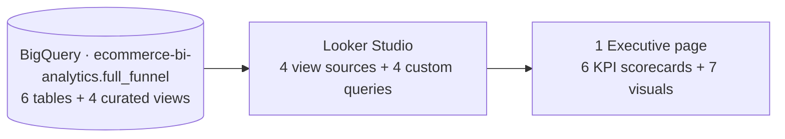

# Full-Funnel Commerce Intelligence — Looker Studio port (BigQuery → Looker Studio)

The same BigQuery warehouse behind the Power BI flagship and the Metabase port, rebuilt as a single-page **Looker Studio** Executive report. Eight data sources — the four curated `vw_*` views plus four hand-written custom SQL queries — on one direct BigQuery connection, with no extracts, no blends and no duplicated metric logic. Every acceptance gate for the Executive page reproduces against the warehouse.

> ### ⚠️ Data disclosure — synthetic demonstration data
> Same disclosure as the flagship: this is a **self-directed portfolio project**. It contains **no real customer data** and is **not client work**. Orders are a synthetic Shopify export; the GA4 funnel and Meta/Google ad-spend layers are simulated by a seeded generator (`../generate_funnel.py`). This port contains **no tracking/tag implementation**.

**Skills demonstrated:** Looker Studio report design · BigQuery custom SQL · source-level field modeling (renames, calculated fields) · cross-tool metric parity · funnel, attribution and unit-economics analysis.

---

## 📊 The Executive page

**Six KPI scorecards:** `$6.25m` GMV · `$6.18m` net revenue · `$1.49m` ad spend · `4.20` gross MER · `$299.42` blended CAC · `11,718` valid orders.

**Seven visuals:**

1. **Session funnel (GA4)** — five steps, `1,327,199 → 417,676 → 45,239 → 23,889 → 11,133`, with the step-rate and 585 session/order-grain caption.
2. **Three-way attribution reconciliation** — platform claimed `1.39` · paid last-click `1.10` · gross MER `4.20` · net MER `4.15`.
3. **Monthly net revenue vs ad spend** — 24 months (Sep 2024 – Aug 2026), bars + line.
4. **Valid net revenue by channel** — Internal `$232,459.32` · Organic `$4,312,575.76` · Paid `$1,636,464.21`, with the order-mix caption (`441 / 8,032 / 3,245`).
5. **Customer order tier mix** — `1,516 / 1,544 / 1,912` (4,972 customers).
6. **Campaign unit economics** — 10 campaign rows: orders, GMV, refunds, net revenue, ad spend, net MER, CPA.
7. **Order-status gross-to-net walk** — five statuses plus Looker's native `Grand total` row: `12,000 → 11,718`.

Every revenue metric applies `is_valid_revenue_order = 1` (paid + partially_refunded); GMV and net revenue are never interchanged.

---

## 🗂️ Eight data sources

| # | Source name in the report | Type | Backing object | Feeds |
| --- | --- | --- | --- | --- |
| DS1 | `Full-Funnel · Reconciliation summary` | BigQuery table | `vw_reconciliation_summary` | 6 KPI scorecards |
| DS2 | `Full-Funnel · Daily funnel + spend` | BigQuery table | `vw_daily_full_funnel` | Monthly net revenue vs ad spend |
| DS3 | `Full-Funnel · Orders` | BigQuery table | `vw_orders_enriched` | Channel split |
| DS4 | `Full-Funnel · Customers` | BigQuery table | `vw_customers` | Customer tier mix |
| DS5 | `Funnel steps` | **Custom query** | [`sql/ds5_funnel_steps.sql`](sql/ds5_funnel_steps.sql) | Session funnel |
| DS6 | `Attribution reconciliation` | **Custom query** | [`sql/ds6_attribution_reconciliation.sql`](sql/ds6_attribution_reconciliation.sql) | Reconciliation bars |
| DS7 | `Campaign unit economics` | **Custom query** | [`sql/ds7_campaign_unit_economics.sql`](sql/ds7_campaign_unit_economics.sql) | Campaign table |
| DS8 | `Order-status gross-to-net walk` | **Custom query** | [`sql/ds8_order_status_walk.sql`](sql/ds8_order_status_walk.sql) | Status walk table |

### Field prep (renames, formats, calculated fields)

- **DS1** — `shopify_gross_gmv` → **GMV** (currency USD) · `shopify_net_revenue` → **Net revenue** (currency) · `total_ad_spend` → **Ad spend** (currency) · `gross_mer` → **Gross MER** (number, 2 dp) · `blended_cac` → **Blended CAC** (currency, 2 dp) · `shopify_valid_orders` → **Valid orders** (number, 0 dp). Scorecards: *Compact numbers* ON.
- **DS2** — `date` → **Date** (kept as DATE, which is what renders `Sep 2024` month names) · `ga4_net_revenue` → **Net revenue** (currency, compact) · `ad_spend` → **Ad spend** (currency, compact).
- **DS3** — `traffic_type` → **Channel** · calculated **Valid orders** = `SUM(is_valid_revenue_order)` (0 dp) · calculated **Valid net revenue** = `SUM(CASE WHEN is_valid_revenue_order = 1 THEN net_revenue ELSE 0 END)` (currency, compact) · hide the raw flag/revenue fields.
- **DS4** — `customer_order_tier` → **Tier** · calculated **Customers** = `COUNT_DISTINCT(customer_email)` (0 dp).
- **DS5** — `step` → **Step** · `sessions` → **Sessions** · `step_rate_prev` → **Step rate vs previous** · `step_rate_vs_sessions` → **Step rate vs sessions**.
- **DS6** — `comparison` → **Comparison** · `roas` → **ROAS**.
- **DS7** — `channel` → **Channel** · `campaign` → **Campaign** · `orders` → **Orders** (0 dp) · `gmv` → **GMV** · `refunds` → **Refunds** · `net_revenue` → **Net revenue** · `ad_spend` → **Ad spend** · `net_mer` → **Net MER** (number, 2 dp) · `cpa` → **CPA** (currency, 2 dp).
- **DS8** — `status` → **Status** · `raw_orders` → **Raw orders** (0 dp) · `valid_orders` → **Valid orders** (0 dp) · `gross_revenue` → **Gross revenue** · `refunds` → **Refunds** · `valid_net_revenue` → **Valid net revenue** (currency, 2 dp).

---

## 🧮 The four custom queries

The queries follow the verified Metabase questions: DS5, DS7 and DS8 are ported from `02`, `03` and `09`; DS6 is a four-row unpivot of `vw_reconciliation_summary` (the Metabase `08` table adds the narrative notes). Column aliases are lowercased to satisfy Looker Studio (see build notes). Paste each file into **Add data → BigQuery → Custom query**; none contain a trailing semicolon.

| File | Rows | Returns | Port of |
| --- | --- | --- | --- |
| [`sql/ds5_funnel_steps.sql`](sql/ds5_funnel_steps.sql) | 5 | `step_order`, `step`, `sessions`, `step_rate_prev`, `step_rate_vs_sessions` | Metabase `02`, steps 1–5 |
| [`sql/ds6_attribution_reconciliation.sql`](sql/ds6_attribution_reconciliation.sql) | 4 | `sort_order`, `comparison`, `roas` | `vw_reconciliation_summary` unpivot (cf. Metabase `08`) |
| [`sql/ds7_campaign_unit_economics.sql`](sql/ds7_campaign_unit_economics.sql) | 10 | `channel`, `campaign`, `orders`, `gmv`, `refunds`, `net_revenue`, `ad_spend`, `net_mer`, `cpa` | Metabase `03` |
| [`sql/ds8_order_status_walk.sql`](sql/ds8_order_status_walk.sql) | 5 | `status`, `raw_orders`, `valid_orders`, `gross_revenue`, `refunds`, `valid_net_revenue` | Metabase `09` (SQL total replaced by Looker's summary row) |

---

## ✅ Metric parity — Looker Studio vs warehouse

The parity surface is the same as Power BI and Metabase: the curated views, with `is_valid_revenue_order` as the single validity flag and SUM/SUM ratios. Rendered values as verified on the page:

| Acceptance gate | Warehouse (source of truth) | Looker Studio | ✓ |
| --- | --- | --- | --- |
| GMV | `$6,252,668.43` | `$6.25m` (compact scorecard) | ✓ |
| Net revenue | `$6,181,499.29` | `$6.18m` | ✓ |
| Ad spend | `$1,488,730.67` | `$1.49m` | ✓ |
| Gross MER | `4.20` | `4.20` | ✓ |
| Blended CAC | `$299.42` | `$299.42` | ✓ |
| Valid orders / raw orders | `11,718 / 12,000` | `11,718` | ✓ |
| Funnel steps | `1,327,199 → 417,676 → 45,239 → 23,889 → 11,133` | same | ✓ |
| Step rates | `31.5% → 10.8% → 52.8% → 46.6%` | same | ✓ |
| Monthly trend | 24 rows Sep 2024 – Aug 2026 · net `$6,181,499.29` · spend `$1,488,730.67` | same | ✓ |
| Reconciliation | `1.39 / 1.10 / 4.20 / 4.15` | same | ✓ |
| Channel nets (Internal / Organic / Paid) | `$232,459.32 / $4,312,575.76 / $1,636,464.21` | same | ✓ |
| Channel order mix | `441 / 8,032 / 3,245` | same (caption) | ✓ |
| Campaign table | 10 rows; Paid totals `3,245` orders · `$1,636,464.21` net · `$1,488,730.67` spend | same | ✓ |
| Campaign spot checks | Meta Seasonal Promo: `$34,945.54` net · `$109,758.09` spend · `0.32` MER · `$1,590.70` CPA; Meta Retargeting `3.30` MER / `$154.91` CPA; Google Brand Search `10.52` MER / `$50.08` CPA | same | ✓ |
| Customer tiers | `1,516 / 1,544 / 1,912` → `4,972` | same | ✓ |
| Order-status walk (Grand total) | `12,000` raw · `11,718` valid · `$6,385,333.39` gross · `$146,198.45` refunds · `$6,181,499.29` valid net | same | ✓ |

The status-walk gross total (`$6,385,333.39`) sums **all 12,000 orders**, so it is intentionally larger than valid GMV (`$6,252,668.43`); refunds (`$146,198.45`) likewise include excluded orders.

---

## 🧩 Build notes (Looker Studio quirks)

- **Custom-query aliases must be underscore-only.** Spaced aliases exposed by a custom query trigger `Invalid field name` when the field is used in a chart. Friendly labels come from source-level field renames; the four SQL files follow that rule.
- **Inner `ORDER BY` is not honored.** Looker wraps custom SQL for charting, so row order is set at the chart level: funnel `step_order` asc, recon `sort_order` asc, campaigns `Net revenue` desc, status `Status` asc.
- **No SQL total row in the status walk.** Because Looker cannot pin a custom-query total row under chart sorting, the table uses Looker's native summary row (`Grand total`), which sums to exactly the Metabase `09` `Total` row.
- **One connection, no blends.** All eight sources point at `ecommerce-bi-analytics.full_funnel`; no chart mixes sources.
- **No extracts, no scheduled delivery.** Direct-query mode only — the report always reads the warehouse.
- **Compact formatting nuance.** Looker renders compact suffixes lowercase (`$6.25m`); Metabase shows `$6.25M`. Cosmetic only — full-precision values live in the views and table metrics.

---

## 📁 Folder contents

| Path | What it is |
| --- | --- |
| `sql/` | The four paste-ready custom queries (DS5–DS8) |
| `assets/looker_executive_full_page.png` | Full-page render (1830 × 3023) |
| `README.md` | This file |

---

## 🔁 Reproduce

1. Build the warehouse from the repo root: load the six generated CSVs as BigQuery tables, then run `../sql/views.sql` to create the four `vw_*` views.
2. In Looker Studio: **Create → Report → Add data → BigQuery**, authorize, pick project `ecommerce-bi-analytics` and dataset `full_funnel`.
3. Add DS1–DS4 by selecting the four views.
4. Add DS5–DS8 via **Custom query**, pasting each file from `sql/`.
5. Apply the renames, formats and calculated fields listed above.
6. Build the page: six scorecards (DS1), funnel (DS5), recon bars (DS6), monthly time series (DS2), channel bars (DS3), tier donut (DS4), campaign table (DS7), status walk (DS8). Set the four chart sorts, enable the status table summary row, and add the funnel/channel captions.
7. Verify every row of the parity table before publishing.

*Part of the [Shopify-ecommerce-analytics](https://github.com/AHMED0929/Shopify-ecommerce-analytics) portfolio — same warehouse, same numbers, three BI tools.*
