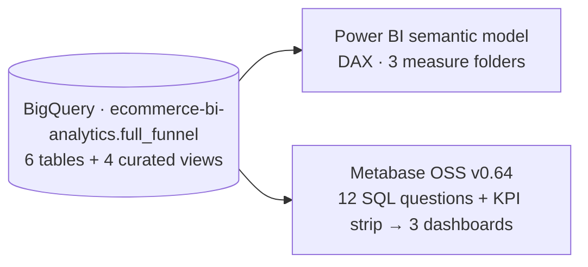

# Full-Funnel Commerce Intelligence — Metabase Port (BigQuery → Metabase)

This folder ports the 3-page Power BI report to **Metabase OSS (v0.64)** using 12 BigQuery SQL queries and a 6-tile KPI strip across 3 dashboards. Because every query reads directly from the same four curated BigQuery views (`vw_*`) as the Power BI model, every metric reconciles to the cent across both tools without needing a separate semantic layer.

> ### ⚠️ Data disclosure — synthetic demonstration data
> This is a **self-directed portfolio project**. It contains **no real customer data** and is **not client work**. Orders come from a synthetic Shopify export, and the GA4 funnel and Meta/Google ad-spend layers are simulated by a seeded Python generator (`../generate_funnel.py`). This project focuses on warehouse modeling and BI reporting, not live tag implementation.

**Skills demonstrated:** BI tool portability, BigQuery SQL, Metabase (OSS) administration, REST API deployment scripts, and cohort, funnel, and financial reconciliation analysis.

---

## 📊 Dashboards

### 1. Full-Funnel Executive

Includes the 6-tile KPI strip (`$6.25M` GMV, `$6.18M` Net Revenue, `$1.49M` Ad Spend, `4.20x` Gross MER, `$299.42` Blended CAC, `$1,120.08` 12-Month LTV), a 17-row executive KPI reference table, the 5-stage GA4 session funnel, 3-way ROAS/MER comparison, campaign unit economics, and 24-month Net Revenue vs. Ad Spend trend.

### 2. Retention & Cohort LTV

Tracks 24 monthly acquisition cohorts across Months 0–12 with a 0–15% color scale, the cumulative LTV curve for mature cohorts (reaching `$1,120.08` at Month 12), customer order-frequency tiers, and first-purchase SKU repeat rates against the 69.5% store baseline.

### 3. Reconciliation & Audit Appendix

Audits the order-status walk from `12,000` raw orders to `11,718` valid orders (with a SQL `Total` row reconciling `$6,385,333.39` gross revenue less `$146,198.45` total refunds to `$6,181,499.29` valid net revenue), the channel revenue walk closing at `4.15x` Net MER, and the 3-way attribution comparison (`1.39x` Meta-claimed vs. `1.10x` GA4 paid last-click vs. `4.15x` store Net MER).

---

## 🗂️ The 12 SQL Questions

Each file in `questions/` is a standalone BigQuery SQL query. The top KPI strip on the Executive dashboard is powered by six additional scalar queries in `questions/kpi/`.

| # | Query File (`questions/`) | Dashboard | Description |
| --- | --- | --- | --- |
| 01 | `01_executive_kpis.sql` | Executive | 17-row summary table (GMV, Net Revenue, AOV, Customers, Repeat Rate/Share, 12M LTV, Spend, MER/ROAS, CAC/CPA) with formula definitions |
| 02 | `02_session_funnel.sql` | Executive | 5 GA4 session stages with step conversion rates, plus a 6th audit row showing the 585 order-to-session grain delta |
| 03 | `03_campaign_unit_economics.sql` | Executive | Orders, GMV, refunds, net revenue, spend, Net MER, and CPA grouped by `traffic_type` and `campaign_name` |
| 04 | `04_cohort_retention_matrix.sql` | Retention | 24 monthly cohorts × Months 0–12 pivoted in SQL (`month_0` to `month_12`) with table conditional formatting |
| 05 | `05_cumulative_ltv_curve.sql` | Retention | Cumulative net revenue per customer across Months 0–12 for mature cohorts (`$1,120.08` at Month 12) |
| 06 | `06_customer_tier_mix.sql` | Retention | Customer counts split by order frequency: 1 order (`1,516`), 2 orders (`1,544`), and 3+ orders (`1,912`) |
| 07 | `07_gateway_sku_test.sql` | Retention | Repeat purchase rate for the top 10 first-order SKUs (`65.5%–73.3%`) compared against the `69.5%` store baseline |
| 08 | `08_three_way_reconciliation.sql` | Executive & Audit | Compares Meta-claimed (`1.39x`), GA4 paid last-click (`1.10x`), and store Net MER (`4.15x`) with methodology notes |
| 09 | `09_order_status_walk.sql` | Audit | Full breakdown of all 12,000 raw orders by `financial_status` (including excluded statuses) with a `UNION ALL` total row |
| 10 | `10_monthly_net_revenue_ad_spend.sql` | Executive | 24-month time series comparing monthly Net Revenue and Ad Spend (`Sep 2024 – Aug 2026`) |
| 11 | `11_cohort_sizes.sql` | Retention | New customers acquired per month across all 24 cohorts (totaling `4,972` valid customers) |
| 12 | `12_channel_walk.sql` | Audit | Net revenue and MER breakdown across Internal (`$232,459.32`), Organic (`$4,312,575.76`), and Paid (`$1,636,464.21`) channels |
| KPI | `kpi/*.sql` | Executive | 6 scalar queries feeding the top KPI cards (GMV, Net Revenue, Ad Spend, Gross MER, Blended CAC, 12-Month LTV) |

---

## 🧮 Metric Parity with Power BI

Because both Power BI and Metabase query the same four views in `../sql/views.sql` (`vw_orders_enriched`, `vw_daily_full_funnel`, `vw_reconciliation_summary`, `vw_customers`), business rules stay consistent without duplicating logic:

- **Order validity:** `is_valid_revenue_order` filters to `paid` and `partially_refunded` orders (`11,718` of `12,000`), keeping the Executive KPIs and the Audit walk aligned.
- **Customer grain:** `vw_customers` enforces one row per distinct valid buyer (`4,972`), providing a consistent denominator for cohort retention and LTV.
- **Ratio math:** All ratios (MER, ROAS, CAC, CPA) use `SAFE_DIVIDE(SUM(x), SUM(y))` rather than averaging pre-aggregated rows.
- **Window functions in place of DAX:** Cohort assignment (`DATE_TRUNC(MIN(order_date) OVER ...)`), month index (`DATE_DIFF`), and order sequencing (`ROW_NUMBER()`) are pre-computed in the SQL view layer.
- **Grain boundaries:** Checkout completion is evaluated at the session grain (`46.6%`), while the `585` difference between valid orders (`11,718`) and purchase sessions (`11,133`) is surfaced explicitly in the audit table.

| Reconciled Metric (Power BI & Metabase) | Verified Value |
| --- | --- |
| GMV → Refunds → Net Revenue | `$6,252,668.43 − $71,169.14 = $6,181,499.29` |
| Valid Orders / Raw Orders | `11,718 / 12,000` (282 excluded orders shown in audit table) |
| Valid Customers · Repeat Rate · Repeat Revenue Share | `4,972` · `69.5%` · `87.3%` |
| 12-Month Net LTV (Mature Cohorts) | `$1,120.08` |
| Total Ad Spend · Gross / Net MER | `$1,488,730.67` · `4.20x / 4.15x` |
| Meta-Claimed / Paid Last-Click / Store Net MER | `1.39x / 1.10x / 4.15x` |
| GA4 Funnel (Sessions → Purchase Sessions) | `1,327,199 → 11,133` (step rates: `31.5% → 10.8% → 52.8% → 46.6%`) |
| Net Revenue by Channel (Internal / Organic / Paid) | `$232,459.32 / $4,312,575.76 / $1,636,464.21` |

### Metabase v0.64 Implementation Notes

1. **SQL-pivoted cohort table:** Metabase v0.64's native Pivot Table enforces a minimum column width that clips Months 10–12 on a single screen. Pivoting `month_0` through `month_12` directly in SQL and applying conditional formatting to a standard table keeps all 13 columns visible without horizontal scrolling.
2. **SQL `Total` rows:** Standard tables in Metabase do not automatically render a grand total footer, so `09_order_status_walk.sql` and `12_channel_walk.sql` append a `UNION ALL` summary row in SQL.
3. **Series labels:** Line and bar chart legend names are set via SQL column aliases so they render cleanly without manual UI overrides.

---

## 📁 Folder Contents

| Path | Description |
| --- | --- |
| `questions/` | The 12 BigQuery SQL queries (plus `kpi/` scalar queries) |
| `automation/deploy_suite.py` | Python script that deploys all questions, cards, and dashboard layouts via the Metabase REST API and checks the returned values |
| `dashboard-spec.md` | Grid coordinates and chart settings for all 3 dashboards |
| `setup.md` | Local setup guide: Java 21, Metabase OSS JAR, and read-only BigQuery service account configuration |
| `assets/` | Dashboard screenshots shown above |

*Note: No credentials or service-account keys are stored in this repository. Environment variables and external key paths are documented in `setup.md`.*

## 🔁 How to Run Locally

1. Follow Steps 1–4 in `setup.md` to start Metabase OSS on `localhost:3000` and connect a read-only BigQuery service account.
2. Run `python automation/deploy_suite.py` to create the questions and dashboards via the Metabase API.
3. Open `http://localhost:3000` and view Dashboards **2** (Executive), **3** (Retention), and **4** (Reconciliation Audit).

*Part of the [Shopify-ecommerce-analytics](https://github.com/AHMED0929/Shopify-ecommerce-analytics) portfolio — same warehouse, same numbers, different BI tool.*
