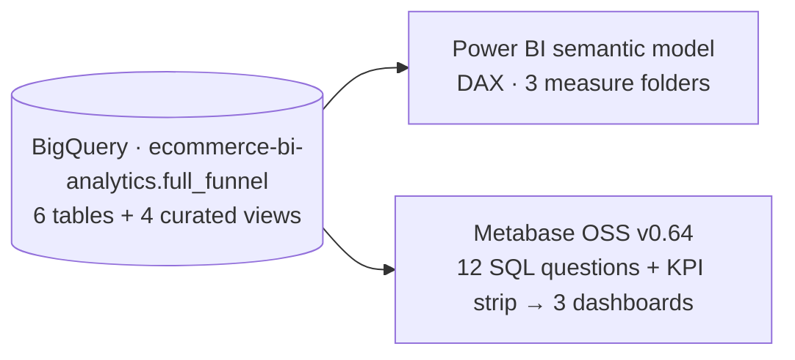
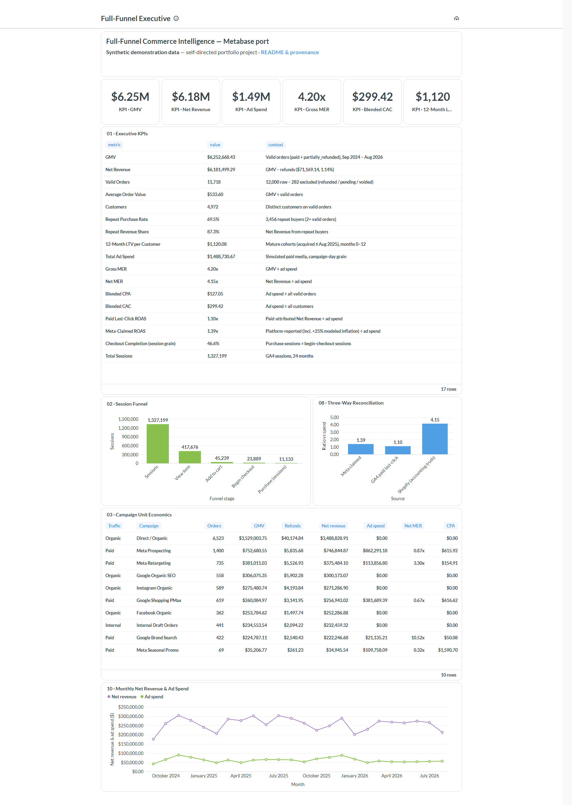
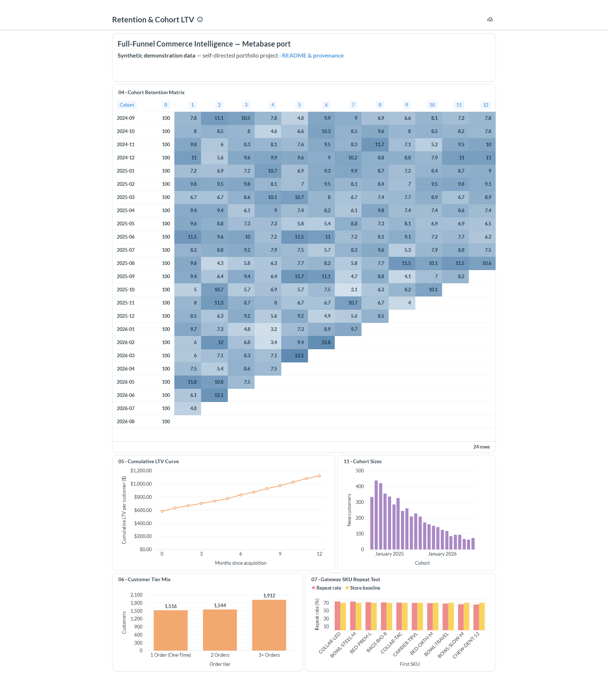
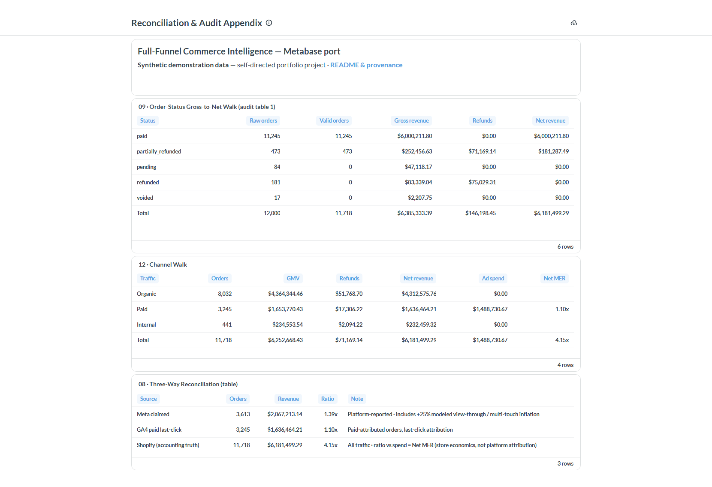

# Full-Funnel Commerce Intelligence — Metabase port (BigQuery → Metabase)

The flagship's three dashboards, rebuilt in **Metabase OSS v0.64** — 12 hand-written BigQuery SQL questions plus a 6-tile KPI strip across 3 dashboards, reading the *same* four curated `vw_*` views as the Power BI report. No semantic layer, no query builder: every metric is explicit SQL, and all **42 gate checks of the Power BI semantic model reproduce to the cent (42/42)**.

> ### ⚠️ Data disclosure — synthetic demonstration data
> Same disclosure as the flagship: this is a **self-directed portfolio project**. It contains **no real customer data** and is **not client work**. Orders are a synthetic Shopify export; the GA4 funnel and Meta/Google ad-spend layers are simulated by a seeded generator (`../generate_funnel.py`). This port contains **no tracking/tag implementation**.

**Skills demonstrated:** BI-tool portability · hand-written BigQuery SQL · semantic-layer-free metric definitions · Metabase (OSS) administration · REST-API deployment automation · cohort, funnel & reconciliation analysis.

---

## 📊 Dashboards

### 1 · Full-Funnel Executive

KPI strip (`$6.25M` GMV · `$6.18M` net · `4.20x` gross MER · …) · 17-row executive KPI table · session funnel with step rates and the 585-grain audit row · claimed vs last-click vs store MER · campaign unit economics · 24-month net revenue vs ad spend.

### 2 · Retention & Cohort LTV

24 monthly cohorts × months 0–12 as a heatmap (fixed 0–15% colour domain) · cumulative LTV curve ending at `$1,120.08` · customer tier mix · gateway-SKU repeat-rate test (documented null result).

### 3 · Reconciliation & Audit Appendix

Order-status gross-to-net walk (`12,000 → 282 excluded → 11,718`, SQL `Total` row: `$6,385,333.39 − $146,198.45 = $6,181,499.29`) · channel revenue walk with SQL `Total` closing paid at `4.15x` net MER · the 3-way reconciliation table (claimed `1.39x` vs last-click `1.10x` vs accounting `4.15x`).

---

## 🗂️ The 12 SQL questions

Each file in `questions/` is a self-contained BigQuery query; the header comment carries the exact question name used in Metabase. The executive KPI strip is six extra scalar queries in `questions/kpi/`.

| # | Question (`questions/`) | Dashboard | What it computes |
| --- | --- | --- | --- |
| 01 | `01_executive_kpis.sql` — Executive KPIs | Executive | 17-row KPI table: GMV, net revenue, AOV, customers, repeat rate/share, 12-month LTV, spend, MER/ROAS, CAC/CPA — each with its definition in a `context` column |
| 02 | `02_session_funnel.sql` — Session Funnel | Executive | 5 session steps with step rates; a 6th audit row proves the 585 purchase-session/order grain gap |
| 03 | `03_campaign_unit_economics.sql` — Campaign Unit Economics | Executive | Orders · GMV · refunds · net revenue · spend · net MER · CPA at `traffic_type → campaign` grain |
| 04 | `04_cohort_retention_matrix.sql` — Cohort Retention Matrix | Retention | 24 monthly cohorts × months 0–12 as a wide table (`month_0 … month_12`), hot via conditional formatting |
| 05 | `05_cumulative_ltv_curve.sql` — Cumulative LTV Curve | Retention | Net revenue per customer by month index for mature cohorts — ends at `$1,120.08` |
| 06 | `06_customer_tier_mix.sql` — Customer Tier Mix | Retention | One-time / 2-order / 3+-order customer counts (`1,516 / 1,544 / 1,912`) |
| 07 | `07_gateway_sku_test.sql` — Gateway SKU Repeat Test | Retention | Repeat rate by first-purchase SKU vs the store baseline — honest null result, no winner |
| 08 | `08_three_way_reconciliation.sql` — Three-Way Reconciliation | Executive (bar) + Audit (table) | Claimed vs last-click vs accounting revenue per $ of spend, with the method note per source |
| 09 | `09_order_status_walk.sql` — Order-Status Gross-to-Net Walk | Audit | Every status contributes its amounts; excluded orders stay visible (fully footable walk + SQL `Total`) |
| 10 | `10_monthly_net_revenue_ad_spend.sql` — Monthly Net Revenue & Ad Spend | Executive | 24-month seasonality, two series (legend names come from SQL aliases) |
| 11 | `11_cohort_sizes.sql` — Cohort Sizes | Retention | New customers per acquisition month (24 bars summing to 4,972) |
| 12 | `12_channel_walk.sql` — Channel Walk | Audit | Internal / Organic / Paid nets (`$232,459.32 / $4,312,575.76 / $1,636,464.21`) + SQL `Total` |
| KPI | `kpi/*.sql` — 6 scalar tiles | Executive strip | GMV · Net Revenue · Ad Spend · Gross MER · Blended CAC · 12-Month LTV |

---

## 🧮 42/42 parity with the Power BI semantic model

**The parity surface is the warehouse layer.** Both tools read only the four curated views defined in `../sql/views.sql` — `vw_orders_enriched`, `vw_daily_full_funnel`, `vw_reconciliation_summary`, `vw_customers` — so grain contracts live in exactly one place:

- **Validity is one flag.** `is_valid_revenue_order` = `paid` + `partially_refunded` (11,718 of 12,000). Every question filters on it, so the audit walk and the KPI table can never drift apart.
- **Denominators are contracts, not conventions.** `vw_customers` is one row per customer (4,972) — the grain behind every cohort percentage and per-customer LTV.
- **Ratios are SUM/SUM.** MER, ROAS, CAC, CPA are computed as `SAFE_DIVIDE(SUM(x), SUM(y))` — the SQL equivalent of the DAX rule that ratios are never averages of averages.
- **Windows replace DAX time intelligence.** Cohort month = `DATE_TRUNC(MIN(order_date) OVER …)` per customer, month index = `DATE_DIFF(order_month, cohort_month, MONTH)`, order sequence = `ROW_NUMBER()` — the same semantics the Power BI model encodes in DAX and `Dim_Date`.
- **Grains are preserved where they matter.** Checkout completion stays session-grain (46.6%), the order/session gap (585) stays visible as its own row, and `first_sku` keeps its documented alphabetical-min caveat.

**Verification.** Every question was executed against the live warehouse through the deployed instance (not just written), and the port's deploy script re-asserts row counts and headline KPI values on every run. The checks that close the loop:

| Gate (identical in both tools) | Value |
| --- | --- |
| GMV → refunds → Net revenue | `$6,252,668.43 − $71,169.14 = $6,181,499.29` |
| Valid orders / raw orders | `11,718 / 12,000` (282 excluded, all visible) |
| Customers · repeat rate · repeat revenue share | `4,972` · `69.5%` · `87.3%` |
| 12-month LTV (mature cohorts) | `$1,120.08` |
| Total ad spend · Gross / Net MER | `$1,488,730.67` · `4.20 / 4.15` |
| Claimed / last-click / store ROAS | `1.39 / 1.10 / 4.15` |
| Funnel steps (sessions → purchase sessions) | `1,327,199 → 11,133`; rates `31.5% → 10.8% → 52.8% → 46.6%` |
| Channel nets (Internal / Organic / Paid) | `$232,459.32 / $4,312,575.76 / $1,636,464.21` |

### v0.64 implementation notes

Three platform quirks worth knowing (all documented in `dashboard-spec.md`): the cohort heatmap ships as a **wide native table + conditional formatting** rather than a pivot (the v0.64 pivot enforces a minimum cell width that clips later months); plain tables have no native totals, so `Total` rows are **computed in SQL** (`UNION ALL`); chart series names come from **SQL aliases**, because viz-level titles style tables only.

---

## 📁 Folder contents

| Path | What it is |
| --- | --- |
| `questions/` | The 12 SQL questions (+ `kpi/` scalar tiles) |
| `automation/deploy_suite.py` | One-command, idempotent deploy via the Metabase REST API — creates every card, tile and dashboard, lays out the 24-column grid, then prints a verification table (see `automation/README.md`) |
| `dashboard-spec.md` | Exact per-dashboard layout + every platform workaround |
| `setup.md` | Step-by-step: Java 21 → Metabase OSS → read-only BigQuery service account → connection |
| `assets/` | The three dashboard renders embedded above |

**Credentials never live in this folder.** The deploy script reads the Metabase admin login from environment variables or a local file outside the repo; BigQuery access uses a read-only service account keyed outside the repo (see `setup.md`).

## 🔁 Reproduce

1. Follow `setup.md` §1–4: install Java 21, run Metabase OSS, create a read-only BigQuery service account, connect the database.
2. Run `python automation/deploy_suite.py` — deploys the full suite and verifies it.
3. Open `http://localhost:3000` → dashboards **2** (Executive), **3** (Retention), **4** (Audit).

*Part of the [Shopify-ecommerce-analytics](https://github.com/AHMED0929/Shopify-ecommerce-analytics) portfolio — same warehouse, same numbers, different BI tool.*
